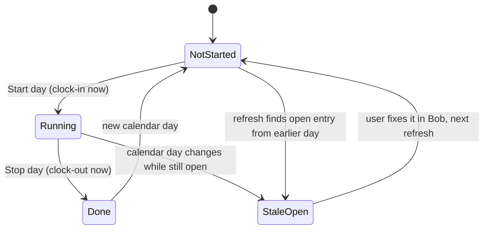

# Bob Clock — macOS menu bar app for starting and stopping the workday in Bob

Status: draft for approval · Date: 2026-11-01

## Intent

A minimal macOS menu bar app that records the start and end of the workday in
Bob (HiBob) attendance. It replaces opening Bob's web or mobile app twice a day.
It is distributed through the author's own Homebrew tap,
[RikuVan/homebrew-formulae](https://github.com/RikuVan/homebrew-formulae).

[Doist/bob-cli](https://github.com/Doist/bob-cli) is the reference for talking to
Bob (service-user Basic auth against `https://api.hibob.com/v1`), but it has no
attendance support. No code from it is reused.

## Goals

- One click to start the day, and one click to stop it, both recorded in Bob at the current time.
- The menu always reflects Bob's real state, including clock-ins made on the web or phone.
- Optional reminders (nudges) to start and to stop, with configurable times and days.
- Credentials can be entered once, are checked before saving, and are stored securely.
- Installed with `brew install --cask rikuvan/formulae/bob-clock`.

## Non-goals

- More than one start/stop pair per day. Breaks are handled by the company's attendance policy.
- Projects, tasks, comments or reason codes on entries.
- Viewing history, or editing or fixing past entries. That is done in Bob.
- Skipping reminders on holidays or time off. This would need an extra time-off permission, and the user chose to ignore it.
- Windows, Linux, and Intel Macs.

## Anti-goals (failure even if it "works")

- Writing incorrect hours to Bob without telling the user, e.g. closing an overnight entry with a 20-hour duration.
- A shared or company-wide token. Each user has their own service user, scoped to themselves.
- Storing the API token anywhere except the Keychain.
- A Dock icon, a main window, or anything that demands attention beyond the menu and the opt-in nudges.

## Constraints (from Bob's API docs)

- **Auth:** HTTP Basic with `serviceUserId:token`.
- **Permission:** the service user's permission group needs *People's data > Time attendance > Manage time attendance sheets* ([attendance reference](https://apidocs.hibob.com/reference/attendance.md)). Under *Access data for*, the admin should choose *Select people by name* and pick only the user ([service users §3.3](https://apidocs.hibob.com/docs/api-service-users)).
- **Employee ID:** a service user isn't tied to an employee, so the user must provide their Bob employee ID. It is used in the endpoint paths.
- **Clock in:** `POST /attendance/employees/{employeeId}/entries/clock-in` with body `{"clockInTime": "YYYY-MM-DDTHH:MM:SS"}`. `entryType` defaults to `work`.
- **Clock out:** `PATCH /attendance/employees/{employeeId}/entries/clock-out` with body `{"clockOutTime": …}`. It closes the most recent open entry. The date part must be today. 404 means "no open clock-in" (or the feature isn't enabled).
- **Read state:** `POST /attendance/entries/search` needs an `employeeId` `equals` filter and `clockInDate` `from`/`to` filters (at most 33 days). It returns `items[].fields["/attendanceEntry/…"].value`. An entry is open when it has `clockInTime` but no `clockOutTime`.
- **Entry rules:** no future entries. For start/end entries, the clock-in and clock-out must be on the same date ([Explore Attendance API](https://apidocs.hibob.com/docs/explore-attendance-api)). So an entry left open overnight probably can't be closed from the app.
- **Locked cycles:** entries can't be changed once the timesheet cycle is submitted, approved or locked.
- **Rate limits:** 100 requests per minute for clock-in/out, 200 for search. Not a concern at this usage level.
- **Timestamps:** the docs' examples have no UTC offset. Send local wall-clock time in the same format, and confirm this in the first spike (see Open risks).
- **The attendance module is a paid Bob add-on.** If it isn't enabled, the API returns 404.

## Approaches considered

| Approach | Tradeoff | Outcome |
|---|---|---|
| **Native Swift / SwiftUI** | Apple frameworks cover the menu bar, Keychain, notifications with action buttons, and launch at login. A few MB, low memory. Swift 6.4 is installed. Xcode is not, so it builds with SwiftPM and a bundling script. | **Chosen by the user** |
| Tauri (Rust + TypeScript) | TypeScript UI, closer to bob-cli. About 10 MB. Rust isn't installed. Keychain, notification actions and login items all come from plugins. | Rejected |
| Electron | About 150 MB for two buttons. | Ruled out |
| SwiftBar/xbar plugin | Requires installing another app. No action buttons in notifications. | Ruled out |

Distribution:

| Option | Tradeoff | Outcome |
|---|---|---|
| Own tap, unsigned (ad-hoc signed) | Free. The cask clears quarantine in `postflight`. Users trust the tap and skip Apple's malware check. | Rejected once the user decided to renew their Apple Developer subscription |
| **Signed + notarized**, in own tap | Apple Developer Program ($99/yr, user is renewing). Notarization in CI. No quarantine workaround. Also keeps the official Homebrew cask repo open as an option later (it requires Gatekeeper-passing apps since 2026-09-01). | **Chosen by the user** |

## Product behaviour (decided with the user)

### First run and Settings

- On first launch, or whenever credentials are missing, the Settings window opens.
- It has three fields: **Service user ID**, **Token**, **Bob employee ID**. It assumes the user already has them.
- A **"How do I get these?"** link opens a help panel built into the app (not a web link). The panel explains:
  - what a service user is
  - what to ask a Bob admin for: the permission named above, with *Access data for* set to *Select people by name* and only you selected
  - where to find your employee ID: open your profile in Bob and copy the long number after `/employee-profile/` in the URL (e.g. `https://app.hibob.com/employee-profile/3332883884017713238`). This is the backend ID the API uses in paths. It is **not** the company employee number (`work.employeeIdInCompany`) ([Bob docs](https://apidocs.hibob.com/docs/update-employee-data)). The Settings field should accept only digits and should mention that it is not the employee number.
- **Save** first runs the validation check (below). Credentials are only stored if the check passes. Otherwise the window stays open and shows the reason.
- After that, Settings is opened from the menu. It also holds the reminder settings and the **Launch at login** toggle (on by default).

### Validation check

The check calls `POST /attendance/entries/search` for the employee, covering today and a few days back. It doesn't write anything.

| Result | Message |
|---|---|
| 200 | Valid. Store the credentials and derive the current state. |
| 401 | ID or token is wrong. |
| 403 | Missing the *Manage time attendance sheets* permission, or not scoped to this employee. The message links to the help panel. |
| 404 | Attendance isn't enabled for this company in Bob. |
| Network error | Can't reach Bob. Nothing is stored. |

The docs don't say whether a token scoped to *other* people returns 403 or an empty list for this employee. If it's an empty list, a misconfigured token would pass validation. In that case, the first Start fails and shows Bob's error message.

### State model

The app checks Bob at launch, on wake from sleep, when the menu opens, and before any nudge fires. It searches for the employee's entries from today back a few days, and decides the state from the most recent entry:

| State | Condition | Menu | Icon |
|---|---|---|---|
| NotStarted | no work entry today, none open | **Start day** | outline clock |
| Running | open entry clocked in today | "Started 09:02", **Stop day** | filled clock |
| Done | a closed entry today, none open | "Done today, 09:02–17:41" | check mark |
| StaleOpen | open entry from an earlier day | "Clocked in since Mon 09:12. Fix it in Bob", **Open Bob** | warning |
| Error | auth/permission/network failure | Bob's message, **Open Bob**, **Settings** | warning |

Every state also shows **Settings…** and **Quit**.

- **Done means done.** There is no Start in the Done state. A mistaken stop is fixed in Bob.
- **Start and Stop always use the current local time.** No scheduled or backdated times.
- In StaleOpen, the app doesn't offer Stop. Closing across midnight would be rejected, or would produce wrong hours.
- **Errors are not retried automatically.** Bob's error message (from the `error`/`message` field, as in bob-cli's `extractErrorMessage`) appears in the menu.

### Nudges

- In Settings:
  - **Remind me to start:** on/off + time (default 09:30)
  - **Remind me to stop:** on/off + time (default 18:00)
  - **Days:** weekday checkboxes (default Mon–Fri), shared by both reminders
- A nudge is a macOS notification with an action button: **Start day** or **Stop day**. Pressing the button does the same thing as the menu item.
- It fires only if still relevant after a fresh check with Bob: the start nudge only in NotStarted, the stop nudge only in Running.
- At most once per reminder per day. No snooze, no repeats.
- If the Mac was asleep or off at the reminder time, the nudge fires once on wake, if still relevant and still the same day.
- Notification permission is requested the first time a reminder is turned on.

### Storage

- Service user ID, token and employee ID: Keychain, as a single generic-password item for the app.
- Reminder settings and launch at login: `UserDefaults`.

## Platform and build

- Swift, SwiftUI `MenuBarExtra` (menu style), `LSUIElement` (no Dock icon).
- `UserNotifications` with a notification category for each action.
- `SMAppService.mainApp` for launch at login.
- `NSWorkspace` wake notifications for refreshing.
- Minimum macOS 14. Apple silicon only.
- Built with SwiftPM (no Xcode project). A script:
  - assembles `Bob Clock.app` (`Info.plist` with bundle ID, `LSUIElement`, version)
  - signs it with the **Developer ID Application** certificate, with hardened runtime and a secure timestamp (`codesign --force --options runtime --timestamp --sign "Developer ID Application: …"`). The app isn't sandboxed, so no extra entitlements are expected
  - zips it with `ditto -c -k --keepParent`, submits it with `xcrun notarytool submit --wait`, staples it with `xcrun stapler staple`, then zips the stapled app again for release
  - also supports an ad-hoc signed build (`--sign -`, no notarization) for local development, so no certificate is needed to build or run locally
- Product name `Bob Clock`, slug `bob-clock`, bundle ID `dev.richardvancamp.bobClock`. This follows the existing `dev.richardvancamp.pinboardWizard` (designer's call, for the user to confirm). It must not change after the first release, because the Keychain item, preferences, notification categories and login item all depend on it.

## Distribution

- **App repo:** `RikuVan/bob-clock` on GitHub, **public**, so that Homebrew can download release assets without auth. The local working copy is the current directory. Pushing a `v*` tag runs GitHub Actions on `macos-latest`. It imports the Developer ID certificate into a temporary keychain, builds, bundles, signs, notarizes, staples, zips, attaches `bob-clock.zip` to the GitHub release, then sends a `repository_dispatch` (`update-bob-clock`, payload `version`) to `RikuVan/homebrew-formulae` using a `HOMEBREW_TAP_TOKEN` secret. The cask's `url` and `homepage` point at this repo.
- **App repo secrets:** `DEVELOPER_ID_P12` (base64 certificate + private key), `DEVELOPER_ID_P12_PASSWORD`, notarization credentials as an App Store Connect API key (`NOTARY_KEY_P8`, `NOTARY_KEY_ID`, `NOTARY_ISSUER_ID`) used via `notarytool --key/--key-id/--issuer`, and `HOMEBREW_TAP_TOKEN`. An API key is used rather than an Apple ID + app-specific password because it isn't tied to a personal login and can be revoked separately (designer's call, for the user to confirm).
- **Tap:** add `Casks/bob-clock.rb`, following `pinboard-wizard.rb`:
  - `version`, `sha256`, `url` to the release zip, `name`, `desc`, `homepage`
  - `depends_on macos: ">= :sonoma"`, `depends_on arch: :arm64`
  - `app "Bob Clock.app"`
  - `uninstall quit:` with the bundle ID
  - `zap trash:` for preferences. The Keychain item is left for the user.
- **Tap workflow:** the existing `update-cask.yml` has `pinboard-wizard` hard-coded, so it can't be shared as-is. Add a separate `update-bob-clock.yml` modelled on it, with its own dispatch event type (e.g. `update-bob-clock`). It updates the cask, runs `brew audit`, and opens a PR. Leave the existing workflow unchanged.

## Testing expectations

- Unit tests for parsing the search response into a state (each state in the table, including a StaleOpen entry from several days back and a closed entry today plus none open), for mapping HTTP status to messages, and for nudge eligibility (day, time, state, already fired today, firing on wake).
- The HTTP client is injected so state and validation can be tested without Bob.
- Manual smoke test against real Bob before the first release:
  - validation with a bad token, and with a token missing the permission
  - Start, then Stop, then check that both appear in *My attendance*
  - clock in from the web, then check that the menu shows Running

## Open risks to settle early

1. **Timestamp time zone:** check that a local time without an offset is stored as the user's local time in Bob.
2. **Wrongly scoped token:** does it give 403 or an empty list on search? This decides whether validation catches it.
3. **Signing setup:** once the subscription is renewed, the user creates a Developer ID Application certificate and notarization credentials. Do one manual sign → notarize → staple run before relying on CI. Also check that notification action buttons and the `SMAppService` login item work in the notarized build.
4. **Overnight entry:** confirm that clock-out of an entry from a previous day is rejected. If it's accepted, StaleOpen should still not offer Stop (anti-goal: wrong hours).

## Left to the builder

- Code structure, file layout, and test framework (XCTest or Swift Testing).
- Icon artwork (SF Symbols are fine).
- How many days the state lookback covers (about 7 suggested; it must be ≤ 33).
- Exact wording of messages and of the help panel.
- The release workflow details beyond the contract above.
